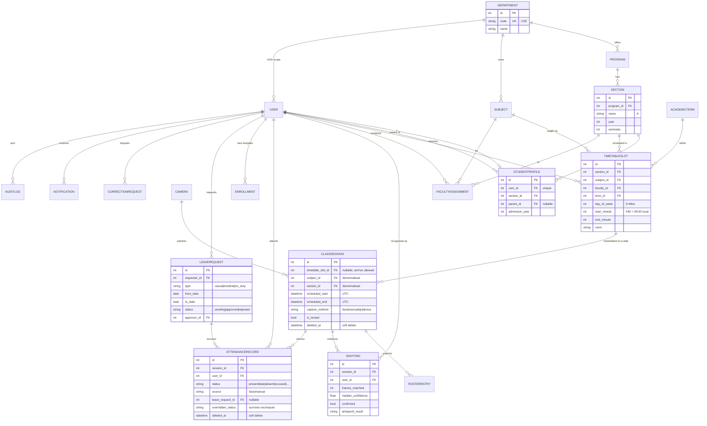

# Schema — Phase 1

Two domains meet in this database.

**Evidence → derivation** (pre-existing, verified): the camera worker appends immutable
`sightings`; `attendance_records` are *derived* from them and can be dropped and rebuilt at any
time. A record is never the only copy of a fact.

**Organisation → schedule** (added in Phase 1): Department → Program → Section is the containment
chain a student sits in. `TimetableSlot` is a recurring weekly period; `ClassSession` is one
dated instance of it. Attendance hangs off the session either way, so face capture and manual
marking write to the same tables.

## ER diagram



## Design decisions worth defending

**`ClassSession` denormalises `subject_id` / `section_id` from its slot.** A session must keep the
context it was recorded in even if the timetable is later edited or the slot deleted. Attendance
that silently changes which subject it belonged to is worse than no attendance.

**Times on `TimetableSlot` are minutes from local midnight, not instants.** A 09:00 lecture stays
at 09:00 across a DST change; a stored UTC instant would drift by an hour. Everything *dated* —
sessions, sightings, records — is stored UTC, per the existing rule.

**`FacultyAssignment` is the authorisation boundary**, not just a lookup. A faculty member may
mark only a (subject, section, term) they are assigned to. Phase 2 enforces this server-side.

**`Setting` does not replace `configs/default.yaml`.** The YAML stays the source of truth for
pipeline thresholds; this table holds only what an admin edits at runtime, and reads fall back to
the YAML so there is exactly one default.

**Soft delete on `User`, `ClassSession`, `AttendanceRecord`.** Attendance is an academic record
that outlives enrolment — a departed student's history must survive their account.

**`EXCUSED` leaves the denominator; `ON_DUTY` counts as present.** These are different things and
conflating them is the classic percentage bug. `COUNTS_PRESENT` and `EXCLUDED_FROM_TOTAL` in
`models.py` are the single definition both the rules engine and the reports use.

## Constraints and indexes

| Constraint | Prevents |
|---|---|
| `uq_record_session_user` *(pre-existing)* | one student marked twice for one period |
| `uq_roster_session_user` *(pre-existing)* | duplicate roster entries |
| `uq_slot_section_period` | a section double-booked in the same period |
| `uq_assignment_identity` | duplicate faculty assignments |
| `uq_section_identity` | two "CSE-A year 3 sem 5" sections |
| `uq_holiday_date_scope` | a date declared a holiday twice for one scope |

Indexed: every foreign key, plus `AttendanceRecord(status)`, `ClassSession(scheduled_start)`,
`ix_sighting_session_user`, `ix_assignment_lookup(subject, section, term)`,
`ix_slot_faculty_day`, `ix_leave_requester_status`, `ix_notification_pending(sent_at, created_at)`.

## Migrations

No Alembic. `app/migrate.py` diffs the mapped metadata against the live database and emits
`ALTER TABLE ADD COLUMN` / `CREATE INDEX` for anything missing.

```bash
python -m app.migrate --dry-run     # show what would change
python -m app.migrate               # apply
```

Additive only, by design — it refuses to drop or retype a column, because SQLite cannot do either
without a full table rebuild and an unattended rebuild of a table holding attendance records is
not acceptable. It also refuses to add a `NOT NULL` column without a `server_default`, which is
what caught three columns during this phase.
